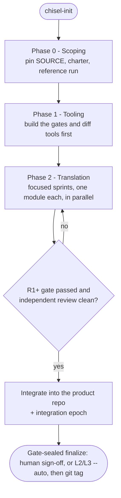

<p align="center">
  
</p>

# Numerical Code Port

Fidelity-preserving translation of numerical codebases from a SOURCE language to a TARGET language
(and, where needed, onto a new execution model), run with agentic coding assistants (opencode) under
human domain-expert direction.

Rewriting numerical code is uniquely dangerous: the worst bugs are silent physics errors that compile
cleanly, run plausibly, and only surface deep into a full-scale run. This methodology makes such a
translation **trustworthy**:

- **Preserve the science, provably** - the original is the specification; the port reproduces its
  behavior by evidence at every stage, never by inspection.
- **Turn silent failures into loud, localized ones** - the differential tooling and the tiered
  validation ladder are built *before* any translation, so a mistake fails a cheap gate at once.
- **Make a long effort cumulative** - all state, lessons, and decisions live in versioned files; any
  sprint, by any agent or human, picks up without repeating a paid-for mistake.

> **Doctrine:** translate literally in stages, validate each stage at the strictest criterion it can
> physically meet, build the differential tooling before you need it, and persist every lesson so no
> sprint repeats a mistake another already paid for.

The methodology is language-agnostic; the languages, the program, and every acceptance criterion of a
given port live in one file, `port/plan/00-charter.md`. The shipped tooling baseline is tuned for a
**C target (Fortran → C)**; a different TARGET extends it at Phase 1. The methodology's own release
version is whatever `VERSION` says (semantic versioning).

## Quick start

```bash
# interactive; add --dry-run to preview (changes nothing)
git clone <base-repo-url> port-foo && cd port-foo
python3 tools/chisel-init.py
```

`chisel-init` is the guided front door. It checks your tooling, asks whether you are **starting** a
new port or **contributing** to one, then does the cloning/wiring and picks each agent's model -
asking before anything that writes, clones, or pushes:

- **New port** flips this clone into your own **instance** (the *workbench*, where all state lives),
  creates the separate clean **product repo** for the ported code, and can import the SOURCE at a
  pinned commit.
- **Contribute** clones an existing instance and wires it to pull base improvements while you work.

Then open the agent and run **`/port-sprint-start`** - it loads the handoff and names your one task.

## How a port flows



Work happens in **sprints** (one bounded chunk - a module and its checks - in one session), grouped
into **phases** (0 scoping, 1 tooling, 2 translation, ...). Each phase/milestone is gate-sealed by `finalize.sh` (hand-driven a human sign-off, or `--auto` in L2/L3 auto-mode)
boundaries, not after every sprint. Each sprint runs in a fresh conversation; the handoff carries the
baton, so no context is hand-copied between them.

## The agents

Four roles with deliberately-separated powers - the one who carves is not the one who reviews, and the
one who schedules is not the one who records or merges, so no single agent can both do work and bless it:

- **Ptah-Orchestrator** - the scheduler and your front door: **this is the agent you talk to.**
  Derives the ready-set, dispatches work to the workers, reports human-readable status, and (opt-in)
  drives auto-mode; never reviews, merges, or self-certifies.
- **Kha-Worker** - the worker. Carves one claimed piece into the TARGET on its own branch/worktree;
  authors and gates it and requests review, but never reviews, merges, or pushes. Many run in parallel.
- **Seshat-Integrator** - the single integration funnel. Orders, preflights, attests, and records the
  integration epoch and canonical TRACE; in autodrive it performs the land via the sanctioned gated
  scripts (the gates are the authority, not the keystroke).
- **port-review** - the independent fidelity reviewer, in its own clean, separate session (ideally a
  different model than the author). In auto-mode the orchestrator dispatches it per piece exactly as a
  human would - the independence layer is never self-driven.

`chisel-init` sets each agent's model and reasoning effort in an instance-local `opencode.json`
(gitignored - your own model choices, never committed or synced). Defaults:

- **Ptah-Orchestrator** and **Seshat-Integrator** → a stronger model
- **Kha-Worker** → a capable, lower-cost model (there are many parallel workers)
- **port-review** → a distinct reviewer model (a stronger independence control than a different session alone)
- **effort** → `high` for every role (written as opencode's provider-agnostic `variant`, validated against the chosen model's provider); raise the reviewer to `xhigh` or the Anthropic agents to `max` for maximum scrutiny

## The commands

You only ever need **`/port-sprint-start`** and **`/port-sprint-end`** - the agent proposes the rest at
the right moment (anything that produces evidence, or that you might forget, has a command):

| Command | When |
|---|---|
| `/port-sprint-start` | First thing in every new conversation - loads the handoff, names the one task |
| `/port-sprint-end` | Task done, or ballooned, or you are stepping away - saves state, writes the next task |
| `/port-lesson` | The moment something surprising happens (a bug, a failed gate, a broken assumption) |
| `/port-gate` | A deliverable is done and its criterion is a script - run the tier, record the evidence |
| `/port-seed` | A new or changed gate/detector - prove it goes red then green before its result is trusted |
| `/port-review` | A module passed its gate - independent walk in a FRESH session; a clean verdict unlocks `gated` |
| `/port-digest` | A phase/milestone is complete - compile the evidence pack + a prefilled `SIGNOFF.md` |
| `/port-sync-with-base` | Pull base methodology improvements into this instance |
| `/port-contribute-to-base` | Send a generalized lesson back to the base (human-approved) |

Running a command is yours by default - except capture-only `/port-lesson`, which the agent auto-runs the
moment a genuine lesson surfaces (it records and reports; you refine). The governance/independence/git ones
(`/port-review` keeps a separate session; milestone acceptance is gate-sealed by `finalize.sh` - hand-driven a human SIGNOFF, or `--auto` in L2/L3 after green conformance at HEAD)
in the loop. `/port-contribute-to-base` the agent may PREPARE and OPEN automatically (its PR is auto-opened
by `contribute.sh` and NEVER merges) - at a phase retrospective, at project end, or whenever local
methodology blocks a sync (then the contribution is the unblocker); your only gate is reviewing and MERGING
that PR on the base, not being asked whether to contribute. A `/port-sync-with-base` you start, but it then
resolves and lands on its own. The binding rules live in `AGENTS.md`; the full methodology in
`.opencode/skill/`.

## Auto-mode (optional, opt-in)

For a parallel port, **Ptah-Orchestrator** can drive the whole wave loop - claim, dispatch, review,
gate, integrate - with no human keystroke. It removes the human *pause*, never a gate: the reviewer is
still a separate agent, the checks still fail closed (any red halts the run), guarded units are never
auto-claimed, and every action commits its evidence to git as it goes (the git history is the record).
Turn it on with **`/port-autodrive enable L1`** - it writes `port/autodrive.yaml` from the template
(a small config) - at one of these levels:

| Level | Behavior |
|---|---|
| **L0** | off - the orchestrator only suggests; you run each action (default) |
| **L1** | plan-and-stop: prints the plan, executes nothing (a dry run - start here) |
| **L2** | auto through the whole CURRENT phase, hands-off; auto-finalizes its milestone (`finalize.sh --auto`), then stops at the phase boundary |
| **L3** | auto across ALL phases, hands-off end-to-end; auto-finalizes each milestone. Acceptance authority = the gates + the per-piece independent reviews bound to each gated commit + the §7 standard you set ONCE in the charter, not a per-milestone keystroke |

Run `/port-autodrive` (or `/port-autodrive status` to just see the plan); every piece still gets the same
independent review a hand-driven one does - the orchestrator dispatches `port-review` per piece in a
separate session, never self-driven. The same loop also drives **Phase 1**
(building the tooling) from `port/phase1-plan.yaml` (scaffolded by `scaffold_phase1_plan.py`) - it gates
the differential harness first, then fans out the gates/checks/diff tools, accepting each only on its
full evidence. Full design:
`.opencode/skill/code-port/references/auto-mode.md`.

## Layout

- `source/` - SOURCE at a pinned commit (read-only by convention)
- the ported code lives in its own clean **product repo** (not here), linked via `port/product.yaml`
- `reference/` - reference-run definitions and checksums
- `tools/` - differential tools, gate scripts, conformance checks, coordination/scoping tooling
- `port/` - durable state: charter, TRACE matrix, LESSONS, KNOWN-DIVERGENCES, handoffs, coordination
- `docs/evidence/` - gate evidence packs for sign-off
- `.opencode/` - canonical `skill/`, `command/`, `agents/`
- `VERSION` - the methodology release version (semantic versioning)

## Reuse: one repo per port

This repo is the **base** (the methodology). Each port is its own **instance** repo that fills the
project layer (`source/`, `port/`, `reference/`, `docs/evidence/`, the project tool subdirs) and shares
the methodology layer (`.opencode/`, `AGENTS.md`, generic `tools/`). We clone to a fresh repo rather
than fork (forks don't scale past one per account). The split is enforced by `.gitattributes` merge
drivers, so `/port-sync-with-base` pulls every base improvement in - methodology files take the base's
side, your project files keep yours - without touching your work, and `/port-contribute-to-base` sends a
generalized lesson back so each new port starts smarter than the last. The instance records its base in
`tools/base-repo.txt`. (Avoid GitHub "template repo" generation - it breaks the cherry-pick lineage
sync/contribute rely on.)

## Where to read more

| You are | Read |
|---|---|
| An agent starting a sprint | `AGENTS.md`, then `/port-sprint-start` |
| A human reviewing | `port/plan/00-charter.md` (the constitution), `docs/evidence/` |
| Anyone needing the methodology | `.opencode/skill/`: `code-port` (what is translated + how it is validated) and `target-conventions` (how it is rendered: naming, comments, trap tables) |
</content>
