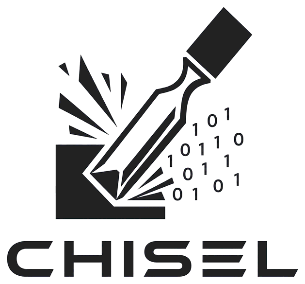

<!--
SPDX-FileCopyrightText: 2026 European Centre for Medium-Range Weather Forecasts (ECMWF)

SPDX-License-Identifier: Apache-2.0
-->

<p align="center">
  
</p>

<p align="center">
  <a href="https://github.com/ecmwf/chisel/actions/workflows/ci.yml"></a>
  <a href="https://github.com/ecmwf/chisel/tags"></a>
  <a href="LICENSE"></a>
  <a href="https://opencode.ai"></a>
  <a href="https://github.com/ecmwf/codex/tree/main/ESEE"></a>
  <a href="https://github.com/ecmwf/codex/raw/refs/heads/main/Project%20Maturity#emerging"></a>
</p>

> [!IMPORTANT]
> This software is **Emerging** and subject to ECMWF's guidelines on [Software Maturity](https://github.com/ecmwf/codex/raw/refs/heads/main/Project%20Maturity).

Chisel is a method and toolkit for porting numerical and scientific code from one language to
another - for example Fortran to C - with AI coding agents, while keeping the results the same.

Rewriting numerical code is risky: the worst bugs don't crash. They compile, run, and produce
numbers that look right but aren't. Chisel is built to catch them:

- **The original code is the specification.** The port has to match it, and every match is shown
  by an automatic check, not by reading the code.
- **Checks come first.** The tools that compare the port with the original are built before
  anything is translated, so a mistake fails early, in one place.
- **Nothing is lost between sessions.** Plans, decisions and lessons are kept as files in the repo,
  so any agent or person can pick up where the last one stopped.

Chisel works for any pair of languages: each port records its choices (languages, program, what
counts as done) in one file, `port/plan/00-charter.md`. The tooling it ships is tuned for Fortran
to C. New here? Start with [the short tour](methodology.md).

## Quick start

You need three tools: git, [uv](https://docs.astral.sh/uv/getting-started/installation/) and
[opencode 2](https://opencode.ai/v2/docs/). uv sets up the Python packages Chisel's tools use, at
the versions pinned in `uv.lock`, so you install nothing else by hand. The GitHub CLI (`gh`) is
optional: with it, setup creates your repos on GitHub for you.

<p align="center">
  
</p>

**1. Clone Chisel under your port's name.**

```bash
git clone https://github.com/ecmwf/chisel.git port-foo
cd port-foo
```

**2. Run the setup.** Add `--dry-run` to preview it without changing anything.

```bash
uv run tools/chisel-init.py
```

The first `uv run` creates `.venv/` with the pinned packages, and a Python if you have none.

It is the only setup command: it runs `new-instance.sh`, `import-source.sh` and `new-product.sh`
itself, and asks before it clones, creates or pushes anything. For a new port it:

- turns `port-foo/` into your **workbench**, your port's own repo (`you/port-foo`), and keeps Chisel
  as `upstream` for updates;
- imports the original code into `source/foo/`, pinned to one commit;
- creates your **product** repo (`you/foo-product`) and clones it as `../foo-product/`: next to
  `port-foo/`, never inside it;
- chooses an AI model for each agent.

**3. Start the first sprint.**

```bash
uv run opencode
```

opencode opens on Ptah-Orchestrator, the agent you talk to. Type `/port-sprint-start`. Always start
opencode this way: the tools the agents run then find their Python packages. The sprint's first step
commits and pushes what the setup prepared; until then, your workbench on GitHub is still a plain
copy of Chisel.

You end up with two folders side by side:

```
~/work/
├── port-foo/          your workbench (you/port-foo): run `uv run opencode` here
│   ├── source/foo/    the original code, pinned
│   ├── port/          charter, plan, progress, lessons
│   └── tools/         Chisel's checks and scripts
└── foo-product/       your product (you/foo-product): the translated code
```

| Repo | What it holds |
|---|---|
| **Chisel** (`ecmwf/chisel`) | The method: agents, commands, checks. Your workbench's `upstream`. |
| **Your workbench** (`you/port-foo`) | The port's record: charter, plan, progress, lessons, proofs, and the original code. |
| **Your product** (`you/foo-product`) | The translated code, its tests and docs, and no trace of Chisel. |

You work in the workbench. Proven code lands in the product only through Chisel's guarded
scripts, and the workbench keeps the proof of why each piece is trusted, so whoever clones the
product gets an ordinary codebase. `/port-sync-with-base` brings Chisel's updates into the
workbench without touching the port's own files, and `/port-contribute-to-base` sends general
improvements back as a pull request. A port is a clone of Chisel, not a fork (GitHub allows one
fork per account) or a template copy (it drops the shared history that syncing needs).

**Joining a port someone else started?** Clone Chisel anywhere, run `uv run tools/chisel-init.py`
and choose *join*. It clones the port's workbench and its product side by side, next to that clone,
which you can then delete. The port's first `/port-sprint-start` must have run, so that its setup is
on GitHub.

**Already ran `tools/new-instance.sh` yourself?** Run `uv run tools/chisel-init.py` next: it sees
that the clone is already your workbench and does the rest.

## How a port flows

<p align="center">
  
</p>

1. **Setup** - `chisel-init` creates the workbench and the product repo.
2. **Phase 0: Scoping** - pin the exact version and settings of the original code, write the
   charter, and record a reference run to compare against.
3. **Phase 1: Tooling** - build the *proofs* (automatic pass/fail checks) and the tools that compare
   the port with the original. Each proof must first be seen to catch a planted bug.
4. **Phase 2: Translation** - translate unit by unit, many units at once. A unit is done only when
   it passes its proof (R1: the same numbers as the original on the same inputs, within the
   tolerance you set) *and* an independent review. Failures go back for rework, and the lesson is
   written down.
5. **Finish** - proven units land in the product repo; each phase ends with a sign-off and a git tag.

Work happens in **sprints**: one task in one fresh conversation. Each sprint ends by writing a
handoff note, so the next one starts from the files, not from memory.

## The agents

Four agents with separate powers, so that no agent can approve its own work. Each agent's
permissions also block the commands its role never runs - a second line behind its instructions and
the guarded landing scripts, not a sandbox:

| Agent | Role |
|---|---|
| **Ptah-Orchestrator** | **The one you talk to.** Plans the work, hands it out, lands what is proven, reports progress. Never reviews. |
| **Kha-Worker** | Translates one unit on its own branch and runs its proof. Many run at once. Never reviews, merges or pushes. |
| **port-review** | Checks a translation against the original in a separate session, ideally on a different model. Never edits the code. |
| **Seshat-Integrator** | Lands proven units in auto-mode, in dependency order, through guarded scripts. Never reviews. |

`chisel-init` makes opencode open on Ptah-Orchestrator and saves each agent's model in
`opencode.json`, which stays on your machine: a stronger model for Ptah-Orchestrator and
Seshat-Integrator, a cheaper one for the many Kha-Workers, and a different one for port-review.

## The commands

You mostly need two: `/port-sprint-start` and `/port-sprint-end`. Ptah-Orchestrator runs the
others when they are due.

| Command | Use it to |
|---|---|
| `/port-sprint-start` | Begin a session: read the handoff and get the task |
| `/port-sprint-end` | End a session: save state and write the next task |
| `/port-lesson` | Record something surprising (the agent does this on its own) |
| `/port-prove` | Run a proof on finished work and save the evidence |
| `/port-calibrate` | Set a tolerance where an exact match is impossible |
| `/port-seed` | Show that a new proof or check catches a planted bug before trusting it |
| `/port-review` | Get an independent review of a unit whose proof is green, and mark it proven |
| `/port-land` | Land a proven unit in the product repo |
| `/port-digest` | Gather a finished phase's evidence for sign-off |
| `/port-autodrive` | Let Ptah-Orchestrator run the loop for you (see [Auto-mode](#auto-mode)) |
| `/port-sync-with-base` | Pull in the latest Chisel improvements |
| `/port-contribute-to-base` | Send a general improvement back to Chisel |

The checks never depend on the agent being checked: reviews run in their own session, and a phase is
sealed by `finalize.sh` only after your sign-off (or, in auto-mode, after every check passes).
`/port-contribute-to-base` shows you the pull request it prepared and opens it only with your OK;
a person merges it. The full rules for agents are in [AGENTS.md](AGENTS.md).

## Auto-mode

Ptah-Orchestrator can also run the loop for you: hand out work, get it reviewed, run the proofs and
land the results. It removes the waiting, not the checks: reviews still run separately, and any
failed check stops the run. A decision only you can make, such as a tolerance, holds only the work
that needs it, and you are asked once. Turn it on with `/port-autodrive enable L1`. Where your
organisation requires a person to merge into a main branch, leave `integrate` out of its scope: each
land then waits for your OK.

| Level | What happens |
|---|---|
| L0 | Off (the default). Ptah-Orchestrator only suggests. |
| L1 | Dry run: Ptah-Orchestrator shows the plan and does nothing. Start here. |
| L2 | Ptah-Orchestrator runs the current phase on its own, seals it, and stops. |
| L3 | Ptah-Orchestrator runs every phase on its own. You set the bar for done once, in the charter. |

The full design is in `.opencode/skills/code-port/references/auto-mode.md`.

## What's in the repo

| Path | Contents |
|---|---|
| `port/` | The port's state: charter, progress (`TRACE.yaml`), lessons, handoffs |
| `source/` | The original code, at a fixed commit, never edited |
| `reference/` | The reference runs the port is compared against |
| `tools/` | Proofs, comparison tools, checks and helper scripts |
| `docs/evidence/` | The proof behind each sign-off |
| `.opencode/` | The agents, commands and skills |
| `VERSION` | Chisel's own version |

The translated code is not here: it lives in the product repo, linked from `port/product.yaml`.

## Learn more

- [The short tour](methodology.md) - how Chisel works, in plain words
- [AGENTS.md](AGENTS.md) - the rules every agent follows
- [CHANGELOG.md](CHANGELOG.md) - what changed in each version
- `.opencode/skills/` - the full method: `code-port` (what to translate and how to check it) and
  `target-conventions` (how to write the translated code)

## Contributing

Contributions are welcome: [CONTRIBUTING.md](CONTRIBUTING.md) says how. To report a security
vulnerability, follow [SECURITY.md](SECURITY.md) instead of opening an issue.

## License

[Apache License 2.0](LICENSE) In applying this licence, ECMWF does not waive the privileges and immunities granted to it by virtue of its status as an intergovernmental organisation nor does it submit to any jurisdiction.
