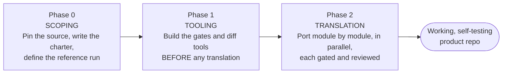
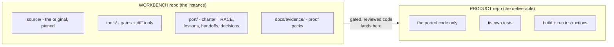
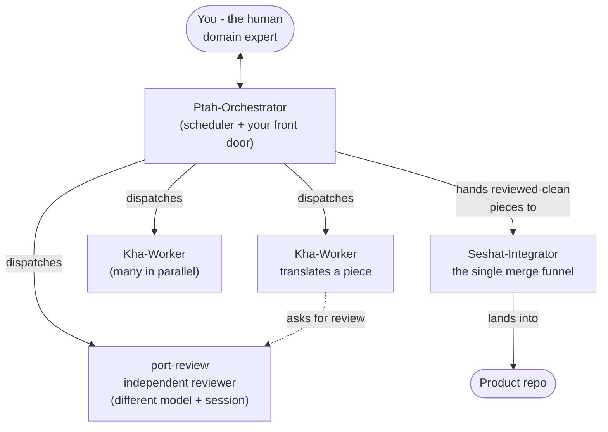
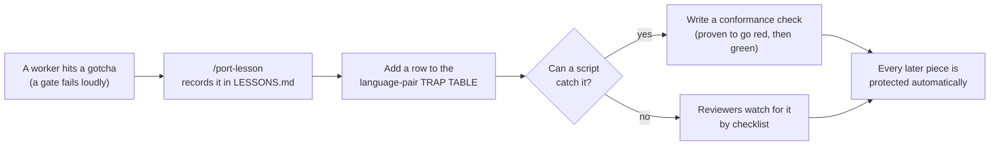
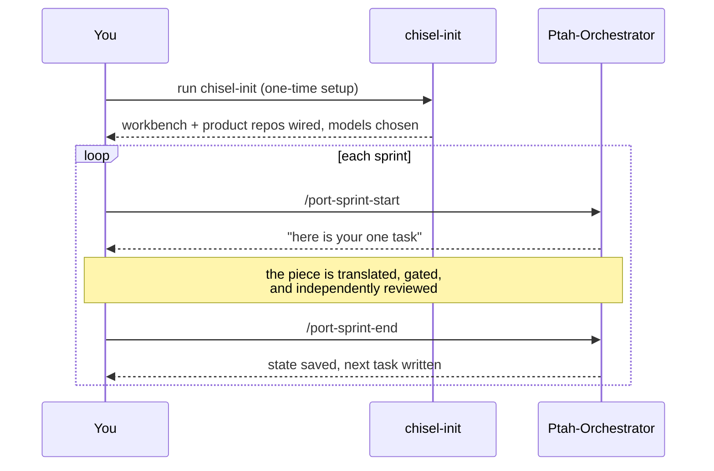
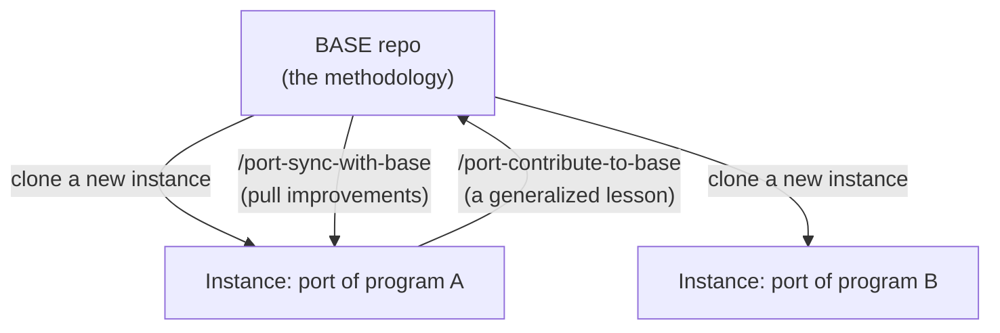

# How this system works

A friendly tour of the methodology - what it does, why it is built this way, and how a port
actually flows. No deep jargon; if you read one thing, read this.

---

## 1. The problem it solves

We translate big **numerical** codebases from one language to another - for example a weather or
climate model from Fortran to C - using AI coding agents, under the direction of a human who knows
the science.

Numerical code is uniquely dangerous to rewrite. The worst bugs are **silent**: the code compiles,
runs, produces plausible-looking numbers, and is wrong in a way nobody notices until deep into a
real run (a mistyped constant, a transposed array, a reordered sum). A normal "looks fine, tests
pass" workflow does not catch these.

So the whole system is built around one promise:

> **Reproduce the original's behavior by evidence at every step - never by inspection.**

The original program is treated as the **specification**. The port is correct only when it can be
*proven* to match it - to the strictest standard the math allows - by an automatic check.

Three principles fall out of that:

1. **Translate literally, in small stages.** Don't "improve" the code while porting. A faithful,
   boring translation is the goal; cleverness is how silent bugs get in.
2. **Build the measuring tools first.** Before translating anything, build the gates and
   diff tools that compare the port to the original. A mistake then fails a cheap check immediately,
   loudly, and in one specific place - instead of surfacing months later.
3. **Make the effort cumulative.** Every lesson, decision, and piece of evidence is saved in
   versioned files, so no sprint - by any agent or human - ever repeats a mistake someone already
   paid for.

---

## 2. Language-agnostic by design

The *method* never mentions a specific language or program. Everything project-specific lives in a
small set of files in one place:

- **`port/plan/00-charter.md`** - the "constitution" of a port: which languages, which program,
  which commit of the source, and exactly what counts as "done" (the acceptance criteria).
- **`port/conventions/<source>-to-<target>.md`** - how this language pair is rendered: naming,
  comments, and a **trap table** of the gotchas between the two languages.

Change those files and the same machinery ports a different program, or a different language pair.
The shipped defaults are tuned for **Fortran to C**, but that is just a starting configuration, not
a hard-coded assumption.

---

## 3. The shape of a port: three phases

A port runs in three phases. The order is the point: you cannot validate what you cannot measure, so
the tooling comes before the translation.

- **Phase 0 - Scoping.** Pin the source code at an exact commit (so it never moves under you), write
  the charter, and capture a trusted **reference run** of the original (the golden output everything
  is compared against).
- **Phase 1 - Tooling.** Build the comparison infrastructure first: the differential harness that
  diffs port-vs-original, the tiered gates, and the conformance checks. Nothing is translated yet -
  this is the "measure twice" investment that makes every later mistake cheap to catch.
- **Phase 2 - Translation.** Now port the program one **module** at a time, many in parallel. Each
  module is translated, must pass its gate, and must pass an independent review before it counts.

The port is not "done" when the code compiles. It is done when the separate product repo can be
**cloned, built, and run** - tests and all.

---

## 4. How "done" is proven: the validation ladder

Each piece is accepted at the **strictest check it can physically meet** - not a vague "it works."
The checks form a ladder, from cheap-and-loose to expensive-and-exact:

| Tier | What it proves | Plain meaning |
|---|---|---|
| **R0** | Intrinsic sanity (bring-up only) | "An equilibrium stays at equilibrium." Used early when there is nothing yet to compare against. **R0 can never be the final gate** - it is scaffolding. |
| **R1** | Per-kernel twin check | The **workhorse**. Run the ported routine and the original side by side on the same live inputs and compare. The aim is **bit-for-bit identical**; only fall back to a calibrated tolerance where the math genuinely can't be exact. A mistyped constant fails instantly. |
| **R2** | Whole-model identity | The full port reproduces the original's every output field over a complete run. |
| **R3 / R4 / R5** | Threaded / accelerator / statistical | Higher bars for parallel, GPU, and long stochastic runs. |

The rule of thumb: **R1 is the lowest tier that may "gate" (accept) a real module.** Higher tiers
make bigger claims as the port grows.

---

## 5. The two-repo work style

There are **two** repositories, with a clean division of labor:

- The **workbench** is where all the *work* happens: it holds the original source, the tooling, and
  every piece of project memory (status, lessons, evidence). It is messy by design - it is the lab.
- The **product** repo holds the finished, ported code, its own tests and build, **and** the README
  and run assets (configs, example inputs) a fresh clone needs to build **and run**. A colleague who
  just wants the result clones *this* one, and it stands on its own. None of the lab apparatus leaks
  into the deliverable.

A piece of code only moves from workbench to product after it has passed its gate **and** an
independent review - through one sanctioned, automated path (never a hand-typed merge).

---

## 6. The agents: separation of powers

Four roles do the work, with powers deliberately split so **no single agent can both do a job and
bless its own work**:

- **Ptah-Orchestrator** - the only agent **you talk to**. It figures out what is ready, hands pieces
  to workers, reports plain-language status, and never reviews or merges anything itself.
- **Kha-Worker** - translates one piece. Many run at once. It writes and gates its piece and *asks*
  for a review, but never approves, merges, or pushes.
- **port-review** - the **independent** reviewer, in a fresh session and (ideally) a *different AI
  model* than the worker. It re-checks the translation against the original from scratch. This is the
  defense against an agent rationalizing its own "harmless improvement."
- **Seshat-Integrator** - the single funnel through which reviewed pieces enter the product, in
  dependency order, through automated gated scripts.

The separation matters because the agents' characteristic failure mode is *over-confidence*. A
different reviewer, on a different model, catching the author's blind spots is the structural
safeguard - not just good intentions.

---

## 7. The self-learning loop

This is the part that makes a long effort get *smarter*, not just longer. Every surprise feeds back
into the system so it never bites twice.

### A concrete example

Fortran arrays start at index **1** and are stored **column-major**; C arrays start at **0** and are
**row-major**. A worker ports a routine and writes the array access the "obvious" way - and silently
**transposes** the data. Nothing crashes; the numbers are just subtly wrong.

Here is what the loop does with that:

1. **The gate catches it loudly.** The R1 twin compares the ported routine to the original on real
   inputs and reports a big difference - immediately, in that one routine, not three months later.
2. **The lesson is recorded.** `/port-lesson` writes it into `LESSONS.md`: *Fortran-to-C array
   indexing reverses dimension order; use the shared index helper.*
3. **It becomes a trap-table row.** The gotcha is added to `port/conventions/fortran-to-c.md` so it
   is part of the standing rules for this language pair.
4. **It becomes an automatic check.** Since a script *can* catch this one, a small conformance check
   is written (and proven to go red on the bug, then green once fixed). From then on, **every other
   module is protected for free** - no worker can repeat the mistake without the check screaming.

The next port of a different Fortran program starts with all of these lessons already baked in.

---

## 8. Repo memory: nothing lives only in a chat

AI sessions forget everything between conversations. So the system keeps **all** durable knowledge in
versioned files, and every sprint starts by reading them. Any agent or human can pick up cold without
re-deriving anything.

| File | What it remembers |
|---|---|
| `port/plan/00-charter.md` | The constitution: languages, program, acceptance criteria |
| `port/TRACE.yaml` | The status of **every** unit - ported? gated? reviewed? where is the proof? |
| `port/LESSONS.md` | Every gotcha learned, so it is never repeated |
| `port/conventions/<pair>.md` | The trap table for the language pair |
| `port/KNOWN-DIVERGENCES.md` | Deliberate, human-approved differences from the original |
| `port/handoffs/*.md` | The **baton**: what just happened and the next task |
| `docs/evidence/` | The proof packs that back each acceptance |

Because work happens in **sprints** (one bounded chunk in one fresh session), the **handoff** is how
the baton passes from one sprint to the next - no context is hand-copied between conversations.

---

## 9. How you actually use it

1. **Set up once** with `chisel-init` - it wires the two repos, imports the source at a pinned
   commit, and picks each agent's AI model.
2. **Work in sprints.** `/port-sprint-start` loads the handoff and names your one task;
   `/port-sprint-end` saves state and writes the next one. You mostly only need these two - the agent
   proposes the rest (record a lesson, run a gate, request a review) at the right moment.
3. **Optionally, turn on auto-mode.** For a big parallel port, the orchestrator can drive the whole
   loop - claim, translate, review, gate, integrate - with no keystrokes, at a level you choose
   (from "just print the plan" up to "run the whole project end to end"). It removes the human
   *pause*, never a *check*: the independent review still happens, the gates still fail closed, and
   every step writes its evidence to git.

---

## 10. One method, many ports: base and instances

This repository is the **base** - the methodology itself. Each port is a separate **instance** repo
that *fills in* the project layer (the source, the state, the project-specific tools) and *shares*
the methodology layer (the agents, commands, generic tooling).

- **`/port-sync-with-base`** pulls base improvements into an instance. A merge-driver rule keeps the
  two layers straight automatically: methodology files take the base's version, your project files
  keep yours - so a sync upgrades the method without ever touching your work.
- **`/port-contribute-to-base`** sends a *generalized* lesson back to the base (as a pull request you
  review). So each new port starts smarter than the last - the whole point of the self-learning loop,
  now operating across projects, not just within one.

---

## In one paragraph

Treat the original program as the spec. Build the tools that measure faithfulness *before* you
translate. Port literally, in small pieces, in parallel - each one proven by an automatic gate and
an independent reviewer on a different model. Keep all state, lessons, and evidence in versioned
files so the effort compounds and never repeats a mistake. Ship the result as a clean, self-testing
repo. And feed every lesson back so the next port - in any language - starts ahead of where this one
began.
